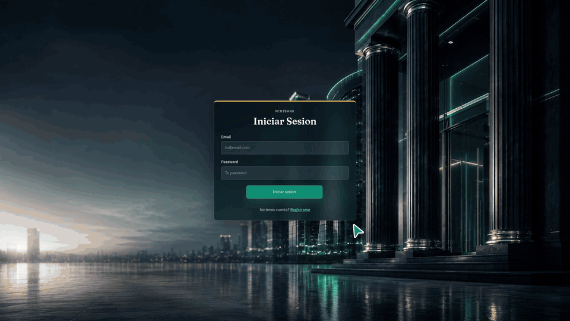

<p align="center">
  <a href="demos/minibank-demo.mp4">
    
  </a>
</p>

<h1 align="center">MiniBank</h1>

<p align="center">
  A small digital bank: a Spring Boot REST API with transactional money movement and a React web app that consumes it.
</p>

<p align="center">
  <a href="README.md">Español</a> | <strong>English</strong>
</p>

<p align="center">
  
  
  
  
  
  
  
  
  
  <a href="LICENSE"></a>
</p>

MiniBank is a portfolio project that simulates a small digital bank. It is built to demonstrate backend engineering (authentication, authorization, transactional money movement, audit logs, PostgreSQL migrations and automated tests) together with a React web app that consumes the API.

> [!NOTE]
> It is intentionally scoped as a modular monolith. It is not a real fintech platform and does not include cards, loans, investments, KYC, external banking integrations or currency conversion.

---

## Features

- Registration and login with JWT, role-based access (`CUSTOMER` / `ADMIN`).
- ARS and USD accounts with account number and editable alias.
- Transfers between accounts with pessimistic locking, daily limits and balance validation.
- Movement history per account and net-worth history per user.
- Audit log of sensitive operations, including rejected attempts.
- Admin panel: users, accounts (block, activate, credit balance), transfers and audit logs.
- Web app with customer dashboard, transfers, movements, limits and admin views.

---

## Stack

- **Backend**: Java 21, Spring Boot 4.1.0, Spring Security + JWT, JPA/Hibernate, springdoc-openapi (Swagger UI), Maven wrapper
- **Data**: PostgreSQL 17.5 + Flyway
- **Frontend**: React, Vite, React Router, custom CSS with CSS modules and design tokens, pnpm
- **Testing**: JUnit 5 + Testcontainers, Vitest + Testing Library

---

## Quick Start

Requirements: **Java 21**, **Docker** with Compose support, **Node.js** and **pnpm**.

One command starts the database, backend and frontend (it creates the `.env` files and runs `pnpm install` when needed):

```bash
./dev.sh          # Linux / macOS
```

```bat
dev.cmd           :: Windows
```

Then open `http://localhost:5173` and sign in with `ana@minibank.local` / `Demo1234!`.

`Ctrl+C` stops the backend and frontend; the database keeps running. `stop` shuts it down and `reset` wipes its data (e.g. `./dev.sh reset`).

<details>
<summary><strong>Start each part separately</strong></summary>

### 1. Database

```bash
cd backend
cp .env.example .env
docker compose up -d
```

The `.env` file is consumed by Docker Compose. The Spring `local` profile has safe defaults, so exporting variables is only needed to override database or JWT settings.

### 2. Backend

```bash
cd backend
./mvnw spring-boot:run
```

The `local` profile is active by default (`SPRING_PROFILES_ACTIVE` overrides it).

### 3. Frontend

```bash
cd frontend
cp .env.example .env
pnpm install
pnpm dev
```

The backend URL is configured with `VITE_API_BASE_URL` (default `http://localhost:8080`), and the backend allows CORS from `http://localhost:5173`.

</details>

### Useful URLs

- Web app: `http://localhost:5173`
- Swagger UI: `http://localhost:8080/swagger-ui/index.html`
- OpenAPI JSON: `http://localhost:8080/v3/api-docs`
- Health: `http://localhost:8080/actuator/health`

---

## Demo Data

The `local` profile adds the Flyway location `classpath:db/demo`, which runs `R__seed_local_demo_data.sql`. It is never loaded outside `local`.

| Role | Email | Password |
| --- | --- | --- |
| ADMIN | `admin@minibank.local` | `Demo1234!` |
| CUSTOMER | `ana@minibank.local` | `Demo1234!` |
| CUSTOMER | `benjamin@minibank.local` | `Demo1234!` |
| CUSTOMER | `carlos@minibank.local` | `Demo1234!` |
| CUSTOMER | `dana@minibank.local` | `Demo1234!` |

Main seeded accounts (the seed also includes extra accounts, transfers, movements and audit logs):

| Owner | Account Number | Alias | Currency | Balance |
| --- | --- | --- | --- | --- |
| Ana | `000000000001` | `ana.ars.demo` | ARS | `351876.65` |
| Ana | `000000000002` | `ana.usd.demo` | USD | `170494.68` |
| Benjamín | `000000000003` | `benjamin.ars.demo` | ARS | `250068.30` |
| Carlos | `000000000011` | `carlos.ars` | ARS | `425000.00` |
| Carlos | `000000000012` | `carlos.usd` | USD | `3000.00` |
| Dana | `000000000013` | `dana.ars` | ARS | `262499.50` |
| Dana | `000000000014` | `dana.usd` | USD | `1250.00` |

> [!TIP]
> To reset the demo after running transfers or admin actions, run `./dev.sh reset` and start everything again with `./dev.sh`.

---

## Testing

```bash
# Backend (from backend/): uses Testcontainers with a real PostgreSQL instance
./mvnw test

# Frontend (from frontend/)
pnpm test
pnpm build
```

---

## Backend Architecture

Modular monolith organized by domain (`auth`, `users`, `accounts`, `transfers`, `movements`, `limits`, `audit`, `common`), each with `controller / service / repository / entity / dto`.

Key decisions:

- UUID identifiers in every main table.
- Amounts as `BigDecimal` / `numeric(19,2)`; never `double` or `float`.
- Versioned Flyway migrations with `ddl-auto: validate`.
- Pessimistic write lock on the source account during a transfer.
- Passwords hashed with BCrypt; JPA entities never exposed through the API.

---

## API Surface

The full, interactive contract is available in Swagger UI.

<details>
<summary><strong>See all endpoints</strong></summary>

Public:

- `POST /auth/register`
- `POST /auth/login`
- `GET /actuator/health`
- Swagger / OpenAPI endpoints

Authenticated customer:

- `GET /auth/me`
- `POST /accounts`
- `GET /accounts`
- `GET /accounts/{id}`
- `GET /accounts/{id}/balance`
- `PATCH /accounts/{id}/alias`
- `POST /transfers`
- `GET /transfers`
- `GET /transfers/{id}`
- `GET /accounts/{accountId}/movements`
- `GET /accounts/{accountId}/limits`
- `PATCH /accounts/{accountId}/limits`
- `GET /me/net-worth/history`

Admin:

- `GET /admin/users`
- `GET /admin/users/{id}`
- `PATCH /admin/users/{id}/block`
- `PATCH /admin/users/{id}/activate`
- `GET /admin/accounts`
- `PATCH /admin/accounts/{id}/block`
- `PATCH /admin/accounts/{id}/activate`
- `PATCH /admin/accounts/{id}/balance/credit`
- `GET /admin/transfers`
- `GET /admin/audit-logs`

</details>

---

## Repository Layout

```txt
/
├── dev.sh / dev.cmd / dev.ps1   # starts DB + backend + frontend
├── backend/                     # Spring Boot / Maven project
├── frontend/                    # React / Vite app
└── demos/                       # demo video and its scenario
```

Backend commands run from `backend/`; frontend commands run from `frontend/`.

---

## Author

**Tomas Gabriel Cardozo**  
Software Developer | Systems Engineering Student

- Portfolio: https://tomascardozo.dev/
- GitHub: https://github.com/TomasCardozo
- LinkedIn: https://www.linkedin.com/in/tomas-cardozo/

---

## License

MIT. See [`LICENSE`](LICENSE).
