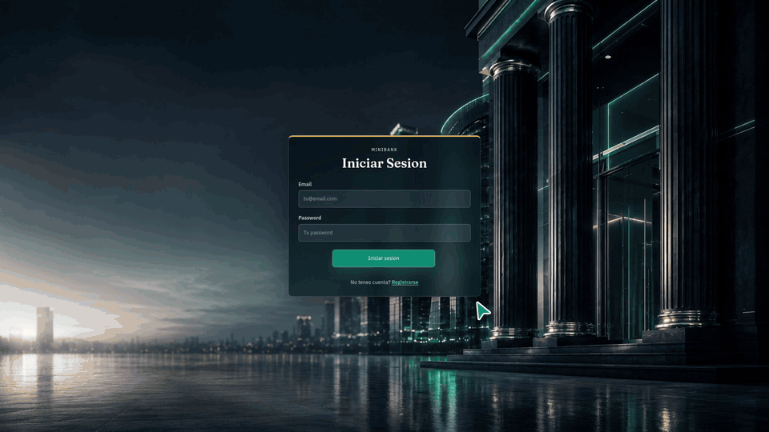

<p align="center">
  <a href="demos/minibank-demo.mp4">
    
  </a>
</p>

<h1 align="center">MiniBank</h1>

<p align="center">
  Un pequeño banco digital: API REST en Spring Boot con movimiento de dinero transaccional y una app web en React que la consume.
</p>

<p align="center">
  <strong>Español</strong> | <a href="README.en.md">English</a>
</p>

<p align="center">
  
  
  
  
  
  
  
  
  
  <a href="LICENSE"></a>
</p>

MiniBank es un proyecto de portfolio que simula un pequeño banco digital. Está pensado para mostrar ingeniería backend (autenticación, autorización, movimiento de dinero transaccional, auditoría, migraciones en PostgreSQL y tests automatizados) junto con una aplicación web en React que consume la API.

> El alcance es deliberadamente acotado: es un monolito modular. No es una fintech real y no incluye tarjetas, préstamos, inversiones, KYC, integraciones bancarias externas ni conversión de moneda.

---

## Funcionalidades

- Registro e inicio de sesión con JWT y acceso por rol (`CUSTOMER` / `ADMIN`).
- Cuentas en ARS y USD con número de cuenta y alias editable.
- Transferencias entre cuentas con bloqueo pesimista, límites diarios y validación de saldo.
- Historial de movimientos por cuenta e historial de patrimonio por usuario.
- Registro de auditoría de operaciones sensibles, incluidos los intentos rechazados.
- Panel de administración: usuarios, cuentas (bloquear, activar, acreditar saldo), transferencias y auditoría.
- Aplicación web con dashboard de cliente, transferencias, movimientos, límites y vistas de administración.

---

## Stack

- **Backend**: Java 21, Spring Boot 4.1.0, Spring Security + JWT, JPA/Hibernate, springdoc-openapi (Swagger UI), Maven wrapper
- **Datos**: PostgreSQL 17.5 + Flyway
- **Frontend**: React, Vite, React Router, CSS propio con CSS modules y design tokens, pnpm
- **Tests**: JUnit 5 + Testcontainers, Vitest + Testing Library

---

## Inicio rápido

Requisitos: **Java 21**, **Docker** con soporte para Compose, **Node.js** y **pnpm**.

Un solo comando levanta la base de datos, el backend y el frontend (crea los `.env` y ejecuta `pnpm install` si hace falta):

```bash
./dev.sh          # Linux / macOS
```

```bat
dev.cmd           :: Windows
```

Después abrí `http://localhost:5173` y entrá con `ana@minibank.local` / `Demo1234!`.

`Ctrl+C` detiene el backend y el frontend; la base de datos queda corriendo. `stop` la detiene y `reset` borra sus datos (por ejemplo `./dev.sh reset`).

<details>
<summary><strong>Levantar cada parte por separado</strong></summary>

### 1. Base de datos

```bash
cd backend
cp .env.example .env
docker compose up -d
```

Docker Compose lee el archivo `.env`. El perfil `local` de Spring tiene valores por defecto seguros, así que solo hace falta exportar variables para cambiar la configuración de la base de datos o del JWT.

### 2. Backend

```bash
cd backend
./mvnw spring-boot:run
```

El perfil `local` está activo por defecto (se puede cambiar con `SPRING_PROFILES_ACTIVE`).

### 3. Frontend

```bash
cd frontend
cp .env.example .env
pnpm install
pnpm dev
```

La URL del backend se configura con `VITE_API_BASE_URL` (por defecto `http://localhost:8080`) y el backend permite CORS desde `http://localhost:5173`.

</details>

### URLs útiles

- App web: `http://localhost:5173`
- Swagger UI: `http://localhost:8080/swagger-ui/index.html`
- OpenAPI JSON: `http://localhost:8080/v3/api-docs`
- Health: `http://localhost:8080/actuator/health`

---

## Datos de demo

El perfil `local` agrega la ubicación de Flyway `classpath:db/demo`, que ejecuta `R__seed_local_demo_data.sql`. Nunca se carga fuera de `local`.

| Rol | Email | Contraseña |
| --- | --- | --- |
| ADMIN | `admin@minibank.local` | `Demo1234!` |
| CUSTOMER | `ana@minibank.local` | `Demo1234!` |
| CUSTOMER | `benjamin@minibank.local` | `Demo1234!` |
| CUSTOMER | `carlos@minibank.local` | `Demo1234!` |
| CUSTOMER | `dana@minibank.local` | `Demo1234!` |

Cuentas principales del seed (también incluye cuentas, transferencias, movimientos y registros de auditoría adicionales):

| Titular | Número de cuenta | Alias | Moneda | Saldo |
| --- | --- | --- | --- | --- |
| Ana | `000000000001` | `ana.ars.demo` | ARS | `351876.65` |
| Ana | `000000000002` | `ana.usd.demo` | USD | `170494.68` |
| Benjamín | `000000000003` | `benjamin.ars.demo` | ARS | `250068.30` |
| Carlos | `000000000011` | `carlos.ars` | ARS | `425000.00` |
| Carlos | `000000000012` | `carlos.usd` | USD | `3000.00` |
| Dana | `000000000013` | `dana.ars` | ARS | `262499.50` |
| Dana | `000000000014` | `dana.usd` | USD | `1250.00` |

> [!TIP]
> Para volver al estado inicial de la demo después de hacer transferencias o acciones de administración, ejecutá `./dev.sh reset` y volvé a levantar todo con `./dev.sh`.

---

## Tests

```bash
# Backend (desde backend/): usa Testcontainers con una instancia real de PostgreSQL
./mvnw test

# Frontend (desde frontend/)
pnpm test
pnpm build
```

---

## Arquitectura del backend

Monolito modular organizado por dominio (`auth`, `users`, `accounts`, `transfers`, `movements`, `limits`, `audit`, `common`), cada uno con `controller / service / repository / entity / dto`.

Decisiones clave:

- Identificadores UUID en todas las tablas principales.
- Montos como `BigDecimal` / `numeric(19,2)`; nunca `double` ni `float`.
- Migraciones versionadas con Flyway y `ddl-auto: validate`.
- Bloqueo pesimista de escritura sobre la cuenta origen durante una transferencia.
- Contraseñas con BCrypt; las entidades JPA nunca se exponen por la API.

---

## Endpoints de la API

El contrato completo e interactivo está disponible en Swagger UI.

<details>
<summary><strong>Ver todos los endpoints</strong></summary>

Públicos:

- `POST /auth/register`
- `POST /auth/login`
- `GET /actuator/health`
- Endpoints de Swagger / OpenAPI

Cliente autenticado:

- `GET /auth/me`
- `POST /accounts`
- `GET /accounts`
- `GET /accounts/{id}`
- `GET /accounts/{id}/balance`
- `PATCH /accounts/{id}/alias`
- `POST /transfers`
- `GET /transfers`
- `GET /transfers/{id}`
- `GET /accounts/{accountId}/movements`
- `GET /accounts/{accountId}/limits`
- `PATCH /accounts/{accountId}/limits`
- `GET /me/net-worth/history`

Administración:

- `GET /admin/users`
- `GET /admin/users/{id}`
- `PATCH /admin/users/{id}/block`
- `PATCH /admin/users/{id}/activate`
- `GET /admin/accounts`
- `PATCH /admin/accounts/{id}/block`
- `PATCH /admin/accounts/{id}/activate`
- `PATCH /admin/accounts/{id}/balance/credit`
- `GET /admin/transfers`
- `GET /admin/audit-logs`

</details>

---

## Estructura del repositorio

```txt
/
├── dev.sh / dev.cmd / dev.ps1   # levanta DB + backend + frontend
├── backend/                     # proyecto Spring Boot / Maven
├── frontend/                    # app React / Vite
└── demos/                       # video de demo y su escenario
```

Los comandos del backend se ejecutan desde `backend/` y los del frontend desde `frontend/`.

---

## Autor

**Tomas Gabriel Cardozo**  
Software Developer | Systems Engineering Student

- Portfolio: https://tomascardozo.dev/
- GitHub: https://github.com/TomasCardozo
- LinkedIn: https://www.linkedin.com/in/tomas-cardozo/

---

## Licencia

MIT. Ver [`LICENSE`](LICENSE).
